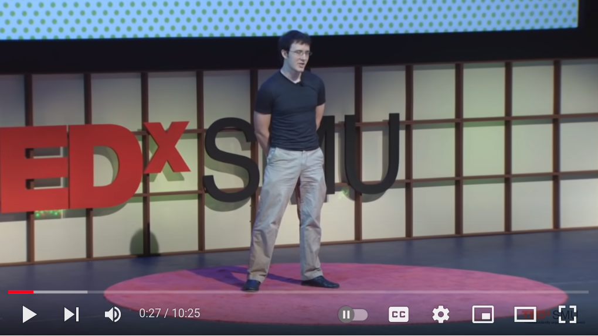
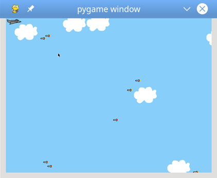
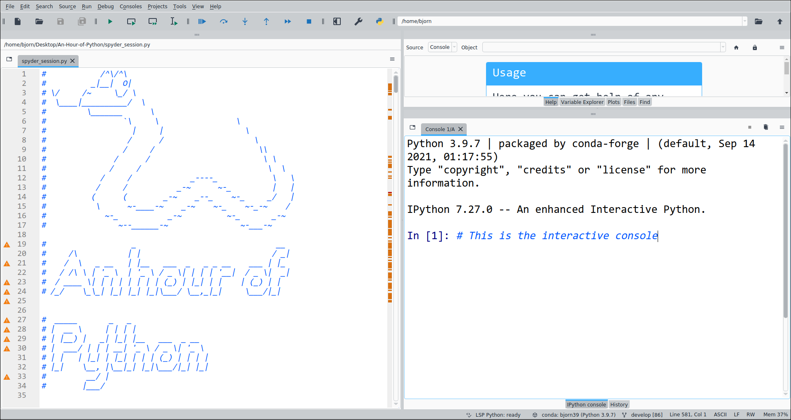
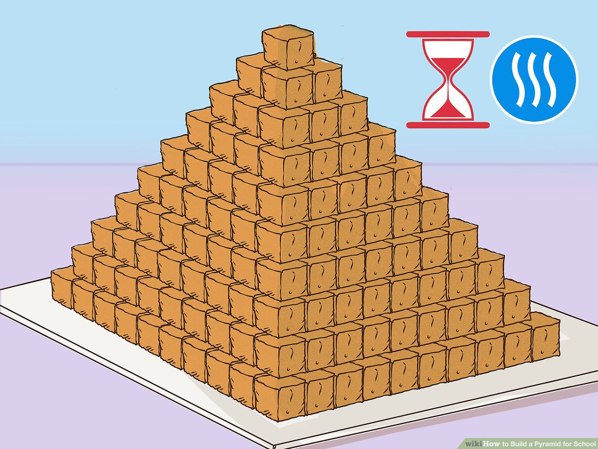

# An-Hour-of-Python

## Programming?

[](https://youtu.be/IY7EsTnUSxY?t=2)

Steve Jobs once [said](https://youtu.be/IY7EsTnUSxY?t=2):


“**Everybody in this country should learn to program a computer, because it teaches you how to think**”.


I fully agree with this, programming is not just a way to solve problems or getting
things done, but it can be so much more.


If you learn programming, you will see how your coding skills can affect the ways you think
as you progress to gain more knowledge. After all, if you know a problem well enough to describe
it to a computer, you probably know it better than most.


[](https://youtu.be/xfBWk4nw440?t=24)


This [TED talk](https://youtu.be/xfBWk4nw440?t=24) (10 min) by [Christian Genco](https://christian.gen.co/you-should-learn-to-program)
sums up the argument in a nice way.


## Python :snake:

[](https://xkcd.com)

Python is a general programming language, the world's most popular in 2019 and its popularity
has [only increased since](https://pypl.github.io/PYPL.html). Python is especially popular in the fields
of [data science](https://en.wikipedia.org/wiki/Data_science)
and [bioinformatics](https://en.wikipedia.org/wiki/Bioinformatics), two fields that should be of interest to a biology student.

Python has a compact syntax (not many keywords to remeber) and easily readable code since it contains few special
characters, such as semicolons.

Compare the two programs below, the first one in C++, another popular coding language
and then the same program in Python.

## C++

```C++
// This C++ program prints Hello, World!
#include <iostream>

int main()
{
    std::cout << "Hello, World!";
    return 0;
}
```

## Python

```python
# This Python program prints Hello, World!
print("Hello, World!")

```
The goal of the program is to print the message "Hello World!" on the screen, which is
probably obvious. I think most people would agree that the Python version is more intuitive.

This is not to say that one computer language (such as Python) is necessarily better than
another for all purposes. However, it is safe to say that Python is probably one of the best for beginners.

Because of its simplicity, Python is also suitable for people who do not code every day (like me).
It is suitable both for quick scripts for automation of some repetitive task but also for complex
software with graphical interfaces and websites.


One of the most important advantages of Python is the **large size of its community**, since this
means that you can often find questions and answers to your coding problems by a simply searching
with [google](https://www.google.com/search?q=loop+over+a+dictionary+python).

An added benefit is the large variety of functionality that has been created and made available
in software packages.

A software package is a collection of files, usually to solve common problems in a specific area
such as statistics or bioinformatics, that has been packaged for distribution and installation.

Widely used Python packages include:
- Numpy - comprehensive mathematical functions
- SciPy - algorithms for optimization, integration, interpolation
- Biopython - tools for biological computation
- Pandas - data analysis and manipulation
- Matplotlib - static, animated, and interactive visualizations
- scikit-learn - efficient tools for predictive data analysis and machine learning
- NLTK - programs to work with human language data
- Pillow - powerful image processing

Python is used for everything from

- Graphical User Interface for sequence checksums ([code](https://github.com/BjornFJohansson/seguid_calculator)).
- Stock and cryptocurrency trading ([video](https://youtu.be/GdlFhF6gjKo)).
- Quantitative Economics ([lectures](https://quantecon.org/python-lectures)).
- Population dynamics ([blog](https://towardsdatascience.com/building-population-models-in-python-57f9e174d27d)).
- Reading data from a commercial temperature data logger ([code](https://github.com/civic/elitech-datareader)).
- Controlling the height of a standing desk [code](https://pypi.org/project/idasen) [video](https://youtu.be/LEXQOhEzVhE?t=404).


You can even make games using Python:

[](https://www.pygame.org)


We will spend one hour (or so) learning the basics of Python using simple examples. The exercises
are aimed at complete beginners with no previous programming experience.

The tutor will demonstrate basic data types, repetition and decision making in the logical flow
of a program. We will use the [Spyder](https://www.spyder-ide.org) integrated development
environment (IDE). At the end we will code a simple example relevant to biology/bioinformatics.


## Installation


The free Anaconda Scientific Python distribution from Continuum analytics is
a nice way to install python on just about any computer. Anaconda is available for the Microsoft
Windows, MacOSX and Linux platforms. Anaconda makes it easy to install Python packages with
extra functionality. The the whole installation is located in one folder in the user's directory
that is easy to uninstall.


Go to the Anaconda [website](https://store.continuum.io/cshop/anaconda) and
download the miniconda installation file for your operating system.

Follow the installation instructions to save the file. Beware that the installation file is large.

Double click the installer and follow the instructions. Select default options when asked.

For installation on Linux, type: ```bash Miniconda3-latest-Linux-x86_64.sh```. in the terminal to start the installation

**If you have any trouble installing, check the detailed instructions [here](https://docs.anaconda.com/anaconda/install).**

The next step is to start the Python editor Spyder. Start “Spyder” from the start menu of your computer.

# Exercises

The Spyder editor was installed with the Anaconda distribution that you should have installed before
this class (See previous section).

[](https://raw.githubusercontent.com/BjornFJohansson/An-Hour-of-Python/main/spyder_session.py)

Download and save the file ```spyder_session.py``` by clicking on the download button above.

**IMPORTANT!** Save the file with a ".py" ending, sometimes MS Windows wants to add a ".txt" file type.
This file will not be recognized by Spyder as a Python file.


Start Spyder from the start menu of your computer. Open the file using the file>open menu of
Spyder. It should look like in the picture below:




Spyder has two important parts, the text editor to the left and the interactive console to the right at the bottom.

We will go through the content of ```spyder_session.py``` together.


## Excercises to do after the session

### cube area

Your task is to define a function that returns the area of a cube with the side X.

```python
def cube_area(x):
    ''' This function should return the area of a cube with the edge x.

               e-------f
              /|      /|
             / |     / |  x
            a--|----b  |
            |  g----|--h
            | /     | /   x
            c-------d
                x
    '''

    # your code here
    return answer
```


Use this function to check your result:

```python
def cube_area_test():
    for edge, expected in [(10, 600), (1, 6), (0, 0), (0.5, 1.5)]:
        result = cube_area(edge)
        print(f"cube_area({edge}): expected {expected}, got {result}")
        assert isinstance(result, (int, float)), "Return a number."
        assert result == expected, "Incorrect cube area."
    print("OK!")
```

### pyramid mass

The task is to define a python function that can calculate the mass of pyramids
(metric tonnes) given a density (kg/m3) of the stone used, the edge size of each
stone (m) and the number of layers.

The pyramid is assumed to be solid and does not contain any internal
open space. The stones used are assumed to be perfect cubes.

The blocks are stacked like this:

- layer 1  - one block
- layer 2  - four blocks
- layer 3  - nine blocks
- layer 4  - sixteen blocks

Example with ten layers:



```python
def pyramid_mass(number_of_layers, density, edge):
    # your code here
    return mass
```


Use this function to check your result:

```python
def pyramidtest():
    from math import isclose

    cases = [(3, 10, 10, 140),
             (1, 1000, 1, 1),
             (0, 1000, 1, 0),
             (2, 2000, 0.5, 1.25)]
    for layers, density, edge, expected in cases:
        result = pyramid_mass(layers, density, edge)
        print(f"pyramid_mass({layers}, {density}, {edge}): "
              f"expected {expected}, got {result}")
        assert isinstance(result, (int, float)), "Return a number."
        assert isclose(result, expected), "Incorrect pyramid mass."
    print("OK!")
```


### Word list counter

```python
def counter(wordlist):
    """
    This function should return the number of words in a list beginning with a
    capital A.

	for example

	country_list = ["Argentina", "Barbados", "Andorra", "Algeria", "Canada", "Denmark"]

	counter(country_list)

	should return the integer 3

    """
    # your code here
    return count
```


Use this function to check your result:

```python
def counter_test():
    country_list = ["Argentina", "Barbados", "Andorra", "Algeria", "Canada", "Denmark"]
    cases = [(country_list, 3), ([], 0), (["Canada", "Denmark"], 0),
             (["Argentina", "Argentina", "apple", "", "A"], 3)]
    for words, expected in cases:
        result = counter(words)
        print(f"counter({words}): expected {expected}, got {result}")
        assert type(result) is int, "Return an integer."
        assert result == expected, "Incorrect word count."
    print("OK!")
```

To run a test, execute both the solution and its test function definition,
then call `cube_area_test()`, `pyramidtest()`, or `counter_test()`.
Each test prints the expected and actual results. An incorrect result raises
an `AssertionError`; if all examples pass, the test prints `OK!`.
